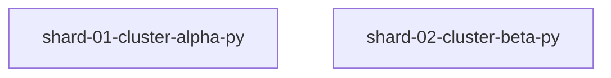

# GhostShard Plan

Mode: **auto-clustered** - auto-clustered (heuristic graph clustering, not a designed split)
Partial: **False**
Max useful parallelism: **2** (largest parallel group)
Per-shard budget: 60000 estimated tokens
_token counts are estimates (GhostSlice-style raw estimator), not exact tokenizer counts_

Planner only: this plan dispatches nothing and runs no agents.

## Shards

| Shard | Owns | Depends on | Est. tokens | Parallel group |
|---|---|---|---|---|
| shard-01-cluster-alpha-py | alpha/alpha.py | - | 354 | 0 |
| shard-02-cluster-beta-py | beta/beta.py | - | 329 | 0 |

## Dependency diagram

## Conflicts and rules fired

- none

Total estimated tokens (sum of shard bundles): 683
Total original tokens: 683
